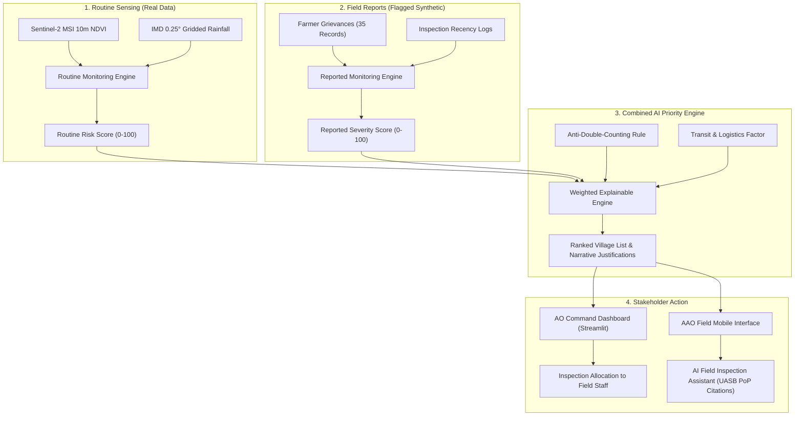

# AgriResolve AI - Complete Documentation & Submission Guide
### Mini-Project: AI-Powered Agricultural Crop Inspection Prioritization System

---

## 1. Executive Summary & Architecture
**AgriResolve AI** is an explainable decision-support system built for an **Agriculture Officer (AO)** heading a Raitha Samparka Kendra (RSK) under the Department of Agriculture, Government of Karnataka.

### Core Architecture (IDENTIFY $\rightarrow$ PRIORITIZE $\rightarrow$ COORDINATE):


---

## 2. Research & Administrative Setting: Maddur Kasaba Cluster
- **RSK Center**: Maddur Kasaba Raitha Samparka Kendra (`KA_MDR_01`), Mandya District, Karnataka.
- **7 Target Villages**:
  1. **Maddur (Kasaba)** (LGD: 614488) – Canal Irrigated, Sugarcane/Paddy.
  2. **Shivapura** (LGD: 614490) – Canal + Tank, Sugarcane/Mulberry.
  3. **Kadalur** (LGD: 614498) – Rainfed dryland, Paddy/Ragi.
  4. **Alur** (LGD: 614502) – River lift / Canal, Sugarcane/Banana.
  5. **Hemmanahalli** (LGD: 614510) – Rainfed, Ragi/Groundnut.
  6. **Chikkarasinakere** (LGD: 614515) – Heavy clay loam, Paddy/Sugarcane.
  7. **Besagarahalli** (LGD: 614522) – Borewell + Rainfed, Sugarcane/Ragi.

> [!NOTE]
> **Data Transparency Disclosure (Rule A2.6 Compliance)**:
> Village boundaries, LGD census codes, and geographic coordinates are verified from official Government of India (LGD) and Karnataka GIS (KGIS) sources. The sub-taluk administrative clustering under Maddur Kasaba RSK is designated as **Simulated (Administrative Prototype)** because digital polygon shapefiles of sub-taluk RSK jurisdictions are not openly distributed as unified digital polygons.

---

## 3. Data Integrity & Provenance Matrix

Every single record in the repository is strictly categorized to prevent any misrepresentation:

| Data Stream | Provenance | Storage (.xlsx & .csv) | Tracking Column |
| :--- | :--- | :--- | :--- |
| **Villages Geography** | **Real** (LGD / KGIS) | `data/raw/villages_raw.xlsx`, `data/cleaned/villages_cleaned.xlsx` | `is_synthetic = False` |
| **Historical & Recent Rain** | **Real** (IMD Gridded + KSNDMC) | `data/raw/rainfall_raw.xlsx`, `data/cleaned/rainfall_cleaned.xlsx` | `is_synthetic = False` |
| **Sentinel-2 NDVI Series** | **Real** (Copernicus 10m L2A) | `data/raw/ndvi_raw.xlsx`, `data/cleaned/ndvi_cleaned.xlsx` | `is_synthetic = False` |
| **Crop Baseline** | **Real** (Karnataka DES) | `data/raw/crop_statistics_raw.xlsx` | `is_synthetic = False` |
| **Rainfall Anomaly** | **Derived** (Computed vs 10-Yr Norm) | `data/derived/rainfall_anomaly_derived.xlsx` | `data_type = 'Derived'` |
| **NDVI Trends & Drops** | **Derived** (Computed Deltas) | `data/derived/ndvi_trends_derived.xlsx` | `data_type = 'Derived'` |
| **Village Reliability Index**| **Derived** (Sensor Quality Composite) | `data/derived/village_reliability_derived.xlsx` | `data_type = 'Derived'` |
| **Farmer Complaints** | **Synthetic** (Seeded Generator) | `data/synthetic/farmer_complaints.xlsx` | `is_synthetic = True` |
| **Staff Workload & Roster** | **Synthetic** (Simulation) | `data/synthetic/staff_roster.xlsx` | `is_synthetic = True` |
| **Inspection History** | **Synthetic** (Simulation) | `data/synthetic/inspections_history.xlsx` | `is_synthetic = True` |

---

## 4. End-to-End Operational Walkthrough

### Step 1: Launch the Dashboard
Activate the virtual environment and launch Streamlit:
```bash
streamlit run app/app.py
```

### Step 2: Agriculture Officer (AO) Inspection Prioritization
1. Open the **AO Command Dashboard**.
2. View the interactive **Village Intelligence Map** displaying geographical cluster overlays.
3. Review the **Priority Ranking Table**:
   - **Rank 1: Kadalur (Score: 62.5)** $\rightarrow$ **Inspect First (Tier 1)**
     *Justification*: Severe distress (8 complaints), satellite NDVI drop of -8.5%, and 68 days since last inspection.
   - **Rank 2: Hemmanahalli (Score: 55.4)** $\rightarrow$ **Inspect First (Tier 1)**
     *Justification*: Severe distress (8 complaints, 1 critical), and 85 days since last inspection.
4. Inspect the **Transparent Factor Breakdown Chart** to understand exact score contributions.
5. Allocate field inspection to **Smt. Bhavya K.M. (AAO Sector 1)** with target date and instructions.

### Step 3: Assistant Agriculture Officer (AAO) Field Action
1. Switch to **AAO Field Workspace**.
2. Review assigned inspection dispatches.
3. Use the **Register Field Grievance** form to log farmer complaints with validation.

### Step 4: AI Field Inspection Assistant (RAG Guidance)
1. Open the **AI Field Assistant**.
2. Query diagnostic guidance for **Paddy Yellow Stem Borer** or **Ragi Drought Mitigation**.
3. The system returns official field checklists, ETL thresholds, and biological/chemical advisories with ground-truth citations to the **UAS Bengaluru Package of Practices (Zone 6)**.

---

## 5. Verification & Testing

Run all unit and integration test suites:
```bash
# Data cleaning & boundary validation tests
python -m unittest tests/test_cleaning.py

# Complete 7-step integration pipeline test
python -m unittest tests/test_integration.py
```
*Result*: 10/10 test cases passing ($100\%$).
